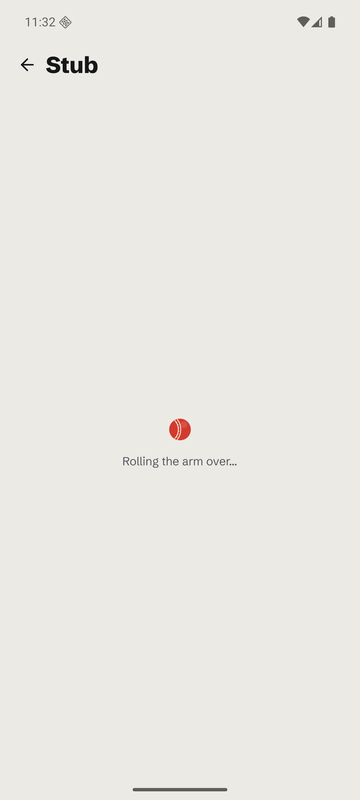
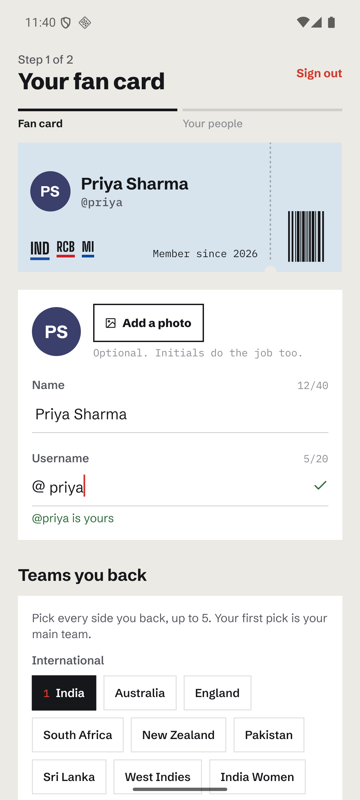
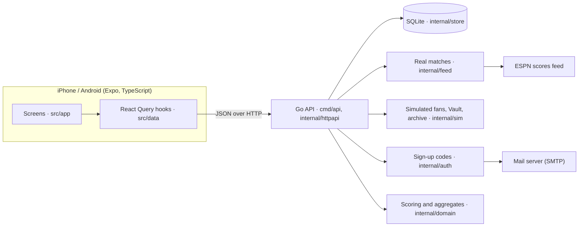

# Innings

**A matchday diary for cricket fans.** Log every match you watch, call it before the first ball, rate the players out of 10, remember where you watched it, and keep a collection of ticket stubs for every game that mattered to you.

I made Innings, from the first plan to a working app for iPhone and Android, by prompting Claude Code. The idea, the plan and the product calls are mine: a Go backend, the Matchday Ticket look, one app for both phones. The app is React Native with Expo, backed by a Go API and SQLite.

**Docs:** [Product requirements (PRD)](docs/PRD.md) · [Requirements and acceptance checks](docs/REQUIREMENTS.md) · [Product plan](docs/PLAN.md) · [API reference](docs/API.md) · [The prompts behind the build](docs/PROMPTS.md) · [Build record](.planning/ROADMAP.md)

**Contents:** [Screenshots](#screenshots) · [Why Innings](#why-innings) · [Features](#features) · [Architecture](#architecture) · [Key decisions](#key-decisions) · [Testing](#testing) · [Getting started](#getting-started) · [Project structure](#project-structure) · [Roadmap](#roadmap) · [Data sources and credits](#data-sources-and-credits)

## Screenshots

**Android** (Pixel 8 emulator):

| Home | Matches | Match Page | Log it |
| --- | --- | --- | --- |
|  |  |  |  |
| **The Vault** | **Profile** | **A friend's stub** | **Dark theme** |
|  |  |  |  |

**Signing up** (Android): a welcome screen, an email and password confirmed by an emailed code, the fan card, and finding friends.

| Welcome | The code | Fan card | Find friends |
| --- | --- | --- | --- |
|  |  |  |  |

**iPhone** (iPhone 17 Pro simulator):

| Home | Match Page | Log it | The Vault | Profile | Dark theme |
| --- | --- | --- | --- | --- | --- |
|  |  |  |  |  |  |

## Why Innings

Cricbuzz tells you **what happened**. CricHeroes helps you **score your own games**. Nobody captures **how fans felt**.

Innings treats every match like a release on opening night, the way Letterboxd treats films. Fans make their call before the first ball and earn bragging points when they're right. They talk the match through while it's on. After the last ball they rate it, crown their own Player of the Match and say where they watched it. Between series, the Vault and an archive going back to 1973 keep the app alive with the matches fans remember.

## Features

**Matches.** Live, upcoming and recent matches by day, from real fixtures and live scores, filtered by India, IPL, WPL, World Cup, BBL, SA20 and The Hundred.

**A Match Page that follows the match.** Before the first ball, fans call the winner, the top run-scorer and the top wicket-taker, locked at the first ball, and say they're watching. While it's on, they see the live score, which friends are watching, and a chat room where the app asks calls on how the match will go, each worth 5 bragging points. Fans can post their own calls in the chat too, five per match. Once it's over, they rate it with a tap, pin it to their Top 5 and write a review. The page shows the fan rating, the fans' player ratings, the Fans' Player of the Match, who called it and where fans watched.

**Logging in under a minute.** Four steps: pick the match, rate it in cricket balls (half-balls allowed), rate both XIs out of 10 and pick a Player of the Match, then say where you watched and with whom. Each log prints a ticket stub with a LOGGED stamp that can be shared as a story.

**Home.** Live and today's matches, *Your Call* on the next big match, friends' stubs with likes, replies and "I was there too", the fans' verdict on matches that just finished, and the week's Bragging Board.

**The Vault and past matches.** 58 fact-checked classics in five collections, all-time fan rankings by format and era, and On This Day. Search reaches every World Cup (men's and women's, ODI and T20), Champions Trophy, Asia Cup and IPL season since 1973, and understands queries like "ind vs aus 2023", so fans can log games they watched years ago.

**Profile.** The fan's Top 5 as big tickets, editable at any time, along with matches logged, average rating, prediction accuracy and points, every stub collected, where they've watched from, and their rank among friends, with badges like *Called the Upset*.

**Accounts.** Sign-up asks for an email and a password, and a 6-digit code emailed to that address confirms it. Fans then set up a fan card with a unique @username and up to five teams, and find friends from their contacts, matched on email addresses that are hashed on the phone and never stored. "Forgot password?" sets a new one with an emailed code, Settings can change the password, and both sign out the fan's other devices. Deleting the account asks for the password first.

## Architecture



**App:** Expo SDK 57 and React Native 0.86 in TypeScript, with Expo Router, React Query, Reanimated and react-native-svg. The design system lives in `src/theme` and `src/components`.

**API:** Go 1.26 on the standard library's `net/http`, with SQLite through `modernc.org/sqlite` and embedded migrations. The JSON contract is `src/domain/types.ts` and `src/domain/api.ts`, mirrored in `internal/domain`, and every endpoint is listed in [docs/API.md](docs/API.md).

## Key decisions

**Go and SQLite instead of a hosted backend.** The plan suggested Supabase. A Go API with SQLite and embedded migrations runs with one command, costs nothing and keeps all data in one file, and the SQL stays ready for Postgres. Photos stay on the phone for now.

**One app for both phones.** Expo and React Native give one TypeScript codebase that runs natively on iPhone and Android. Go runs the server, and the app draws the screens.

**Email sign-in.** Email and password, confirmed by an emailed code, replaced the original phone number and texted code. Texts cost money for every sign-in, while an emailed code proves the address for free. Passwords are hashed with PBKDF2-SHA256 at 600,000 iterations, and the password rules follow NIST SP 800-63B. Sessions are random tokens stored only as hashes, and resetting or changing a password signs out every other device.

**Real match data at no cost.** Fixtures, live scores, squads, playing XIs and results come from ESPN's public scores feed, which needs no account or key. One poller on the server serves every fan from its own copy, so the app never calls ESPN. It looks a week ahead for squads, checks every five minutes before the toss for the playing XIs, and catches up on missed days after the server has been off. The feed is unofficial and can change without notice, so it is read defensively and its tests run on saved real responses. That's fine for a personal project, not for a commercial one. `INNINGS_MATCHES=sim` runs a simulated world instead.

**Accuracy over size.** The Vault holds 58 real matches, each checked against public scorecards ([sources](docs/VAULT_SOURCES.md)). The archive of past tournaments, 2,948 matches from 1973 to 2026, is built by `scripts/archive.py` from Wikipedia's tournament pages, read through Wikipedia's own API and no other site. It checks itself as it builds: each tournament's match count must match its page, each winning margin must match the scores, and every ground must be in a host country. Four games where Wikipedia's margin and scores disagree are left out, as are four walkovers. The app itself never contacts Wikipedia.

The original plan is in [docs/PLAN.md](docs/PLAN.md). Every requirement, with its acceptance check and the exact scoring rules, is in [docs/REQUIREMENTS.md](docs/REQUIREMENTS.md), and all 80 are built: 79 across ten phases, plus past matches.

## Testing

The Go side has table tests for scoring and aggregates, `httptest` checks for every endpoint (including that no list ever comes back as `null`), tests that the simulated world is deterministic, and tests of the real-match feed against saved ESPN responses. Sign-up, codes, passwords and the rate limits have their own tests, and the mailer is tested against a mail server on the same machine. On the app side, 69 Jest tests cover the pure helpers: the log draft, the Top 5, the sign-up checks, contact emails, teams and date formatting. `scripts/smoke.py` runs 88 end-to-end checks against a fresh server, from sign-up to deleting the account.

```bash
make test         # Go tests, then the Jest tests
npx tsc --noEmit  # TypeScript check
npx expo lint     # lint
```

## Getting started

You need Go 1.26+, Node 20+, and Xcode (iOS Simulator) or Android Studio (Android Emulator).

```bash
make api          # Go API on http://localhost:8088 (creates innings.db on first run)
npm install
make app          # Expo dev server; press i for iOS, a for Android
```

Matches are real by default. On start, `make api` fetches today's matches and the week ahead from ESPN's public scores feed, then checks every minute while a match is on and every five minutes otherwise. To run the simulated world instead, for example offline, use `INNINGS_MATCHES=sim make api`.

To try it, tap Get started and sign up with any email address and a password of at least 8 characters. In dev mode nothing is emailed: the code shows on the screen (tap it to fill it in) and in the server log. `make reset-db` starts again with an empty database.

On a real phone, connect it by cable and run `npx expo run:android --device` or `npx expo run:ios --device`, with the phone on the same Wi-Fi as your computer. The app finds the API there automatically, and `EXPO_PUBLIC_API_URL` points it somewhere else.

### Demo

To show Innings to someone, stop `make api` and run `make demo` instead. It starts the API on a fresh `demo.db` with today's real matches and opens demo@example.com, an account that already has stubs, five friends and a Top 5, plus a few made-up predictions on the week's results, with their points, once the feed has loaded them (usually within a few minutes). Sign in on the app with the password it prints, which is new each run. Nothing is emailed, and your own `innings.db` isn't touched. Offline, or on a day with nothing live, `INNINGS_MATCHES=sim make demo` runs it on the simulated world, where one match is always live.

### Real emails

`make api` emails real codes once a file named `.env` in the repo root holds a mail account's settings. The file is gitignored, so the password stays on your computer. To send from Gmail, turn on 2-Step Verification for the account, create an app password at [myaccount.google.com/apppasswords](https://myaccount.google.com/apppasswords), and add these lines to `.env` with your own address, typing the app password without its spaces:

```
SMTP_HOST=smtp.gmail.com
SMTP_PORT=587
SMTP_USERNAME=you@gmail.com
SMTP_PASSWORD=yourapppassword
MAIL_FROM="Innings <you@gmail.com>"
```

Restart `make api`. Its log then says `sign-up emails: SMTP`, and codes arrive by email instead of showing on the screen. Never paste these lines into a chat: anyone with the app password can send mail as you. Real delivery hasn't been tested yet.

## Project structure

```
cmd/api            Go server entry point
internal/httpapi   routes and handlers
internal/store     SQLite storage and migrations
internal/auth      sign-up, sign-in, passwords and emailed codes
internal/feed      real matches from ESPN's scores feed: polling, mapping, saving
internal/sim       simulated fixtures and fans, the Vault and the past-matches archive
internal/domain    JSON types, scoring, aggregates
scripts            the archive builder and the end-to-end smoke test
src/app            Expo Router screens (tabs, match, log, vault, profile)
src/features       screen components by area
src/components     design system: tickets, ball ratings, stamp
docs               PRD, plan, requirements, API reference, prompts, Vault sources
.planning          GSD project record: roadmap, project state and phase plans
```

## Roadmap

Innings has been built and tested on the iOS Simulator and an Android emulator, but it hasn't launched. What comes next, and what was left out on purpose, is in the [PRD](docs/PRD.md#11-out-of-scope-and-future-work).

## Data sources and credits

Live and recent matches come from ESPN's public scores feed, the same data as ESPNcricinfo. Innings uses it for a personal project and isn't affiliated with ESPN. Facts in the past-matches archive come from Wikipedia's tournament pages, available under [CC BY-SA 4.0](https://creativecommons.org/licenses/by-sa/4.0/). The Vault's sources are listed in [docs/VAULT_SOURCES.md](docs/VAULT_SOURCES.md).
