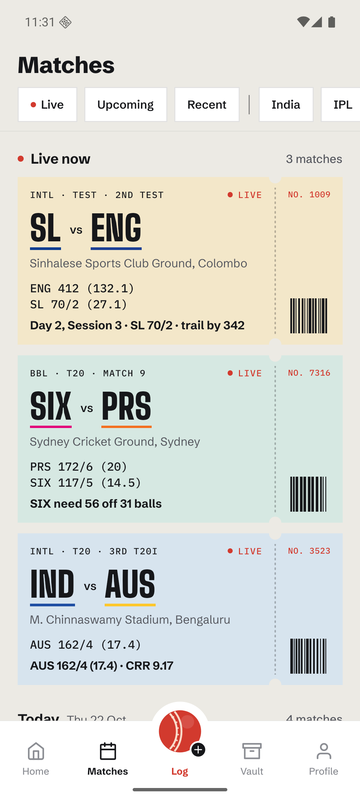
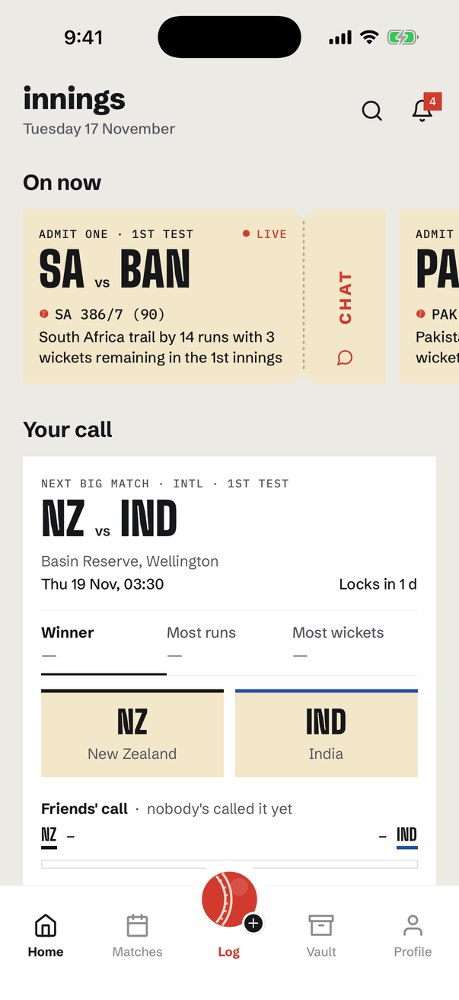
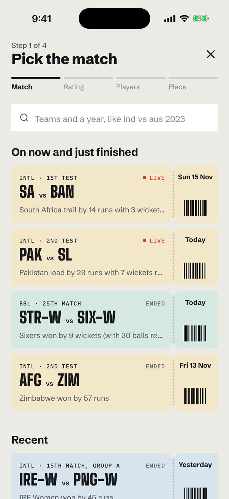
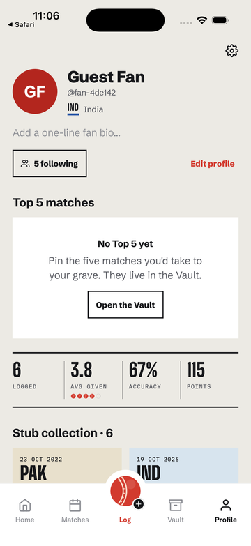
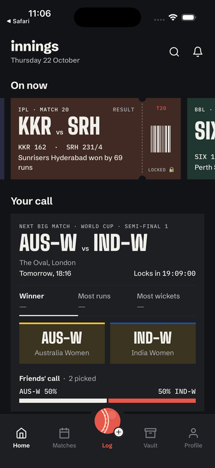
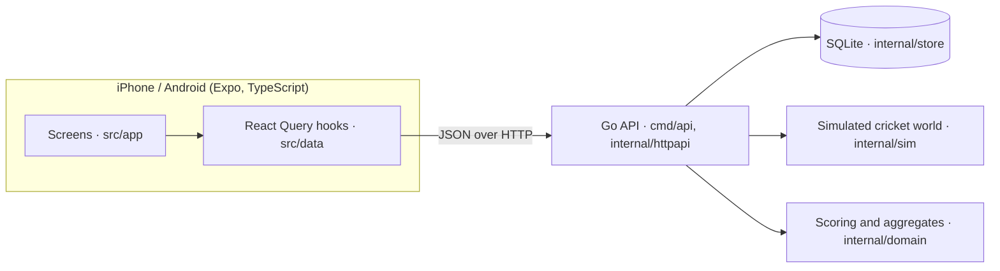

# Innings

**A matchday diary for cricket fans.** Log every match you watch, call it before the first ball, rate the players out of 10, remember where you watched it, and keep a collection of ticket stubs for every game that mattered to you.

I took this from a written plan to a working app for iPhone and Android by directing Claude Code, Anthropic's AI coding assistant. The idea, the plan and the product calls (a Go backend, the Matchday Ticket look, one app for both phones) are mine; Claude wrote the code to my prompts. The app is React Native with Expo, backed by a Go API and SQLite.

**Docs:** [Requirements](docs/REQUIREMENTS.md) · [Product plan](docs/PLAN.md) · [API](docs/API.md) · [Build record](.planning/ROADMAP.md)

**On Android** (Pixel 8 emulator):

| Home | Matches | Match Page | Log it |
| --- | --- | --- | --- |
|  |  |  |  |
| **The Vault** | **Profile** | **A friend's stub** | **Floodlights** |
|  |  |  |  |

**On iPhone** (iPhone 17 Pro simulator):

| Home | Match Page | Log it | The Vault | Profile | Floodlights |
| --- | --- | --- | --- | --- | --- |
|  |  |  |  |  |  |

## The idea

Cricbuzz tells you **what happened**. CricHeroes helps you **score your own games**. Nobody captures **how fans felt**.

Innings treats every match like a release on opening night, the way Letterboxd treats films. Fans rush in after the last ball to rate it, crown their own Player of the Match and say where they watched it. Before the first ball they make their call and earn bragging points when they're right. Between series, the Vault keeps the app alive with the classics everyone remembers where they were for.

## What you can do

| Tab | What's there |
| --- | --- |
| **Home** | Live and today's matches as tickets, *Your Call* on the next big match (winner, top run-scorer, top wicket-taker in three taps), friends' stubs with likes, replies and "I was there too", matches that just finished with the fans' verdict, and the week's Bragging Board. |
| **Matches** | Live, upcoming and recent matches by day, filtered by India, IPL, WPL, World Cup, BBL, SA20 and The Hundred. The **Match Page** changes with the match: predictions and "I'm watching" before, the live score and friends watching during, then the fan rating, fan player ratings, the Fans' Player of the Match ("Fans disagree!" when it isn't the official one), who called it and where fans watched. |
| **Log** (the red ball) | A four-step log in under a minute: pick the match, rate it in cricket balls (half-balls too), rate both XIs out of 10 and pick your Player of the Match, then say where you watched it and with whom. It prints a ticket stub with a LOGGED stamp you can share as a story. |
| **Vault** | 58 classic matches in five collections (World Cup Finals, Greatest Chases, Test Match Thrillers, Super Over Madness, Women's Cricket Classics), all-time fan rankings by format and era, On This Day, and your pinned Top 5. |
| **Profile** | Your Top 5 as big tickets, matches logged, average rating, prediction accuracy and points, every stub you've collected, where you've watched from, and your rank among friends with badges like *Called the Upset*. |

## Key decisions

| Decision | What I chose | Why | What it costs |
| --- | --- | --- | --- |
| Backend | A Go API (standard library `net/http`) with SQLite, instead of the Supabase the plan suggested | Go is what I build backends in. SQLite with embedded migrations means `make api` runs with no setup; the SQL stays Postgres-ready. | No managed auth or storage yet: guest accounts and device-local photos. |
| Phones | One Expo / React Native app for iPhone and Android | One codebase, native on both. Phone screens can't be built well in Go, so Go does the server and the app does the screens. | Two languages in one repo. |
| Match data | A deterministic simulated cricket world, built around server start | No paid cricket API key is needed to try it, and there's always something live, about to start and just finished. Real current XIs and real grounds. | Scores aren't real. A CricketData.org or SportMonks client can replace the simulation behind the same interface. |
| The Vault | Real matches only, each fact-checked | Fans know these games by heart; one wrong date ruins the trust. All 58 were checked against public scorecards; sources are in [`docs/VAULT_SOURCES.md`](docs/VAULT_SOURCES.md). | Slower to grow by hand. |
| Ratings | Five cricket balls with half-balls, everywhere | The plan's signature detail. One scale for logging, averages and rankings. | |
| Predictions | Lock at the first ball; an upset is measured on the fans' split at lock time | Nobody can call it after seeing the toss, and an upset means the same thing for everyone. | |
| Bragging points | +10 winner, +15 top scorer, +15 top wicket-taker, +10 upset; 3–4 correct winners in a row ×1.5, 5+ ×2 | The plan said streaks multiply but not how; this keeps a hot streak worth chasing without swamping single matches. Tied top scorers all count. | |
| Look | "Matchday Ticket": every match printed as a ticket on its competition's card stock | The first pass (a paper scorebook) felt generic. I sketched three directions and chose the one that makes the stub worth sharing. | |

The full plan, with every decision that filled a gap, is in [`docs/PLAN.md`](docs/PLAN.md). What v1.0 has to do, how each requirement is checked and where it's built is in [`docs/REQUIREMENTS.md`](docs/REQUIREMENTS.md): 64 of 64 built. The build was run as GSD phases; the roadmap and per-phase plans and summaries are in [`.planning/`](.planning).

## What's left out on purpose

- **Live mood reactions, Season Wrapped, team fan clubs and AI summaries of reviews.** The plan marks these as later.
- **Store releases.** The same code builds for iPhone and Android, and both have been run: on the iOS Simulator and on an Android emulator. On a real phone, install a development build (`npx expo run:android --device`, or `npx expo run:ios --device` with a free Apple ID); Expo Go from the stores only opens projects on the newest Expo SDK. App Store and Play Store builds need developer accounts.
- **Real accounts.** Everyone is a guest with a device token for now.

## How it's built



- **App:** Expo SDK 57, Expo Router, React Query, react-native-svg and Reanimated. The design system lives in `src/theme` and `src/components`: the ticket stub, ball ratings, the LOGGED stamp.
- **API:** Go 1.26, standard library HTTP, `modernc.org/sqlite`. The JSON contract is `src/domain/types.ts` and `src/domain/api.ts`, mirrored in `internal/domain`. Endpoints are listed in [`docs/API.md`](docs/API.md).
- **Tests:** table tests for scoring and aggregates, `httptest` checks for every endpoint (including that no list ever comes back as `null`), and tests that the simulated world is deterministic.

## Run it

You need Go 1.26+, Node 20+, and Xcode (iOS Simulator) or Android Studio (Android Emulator). For a real phone, see below.

```bash
make api          # Go API on http://localhost:8088 (creates innings.db on first run)
npm install
make app          # Expo dev server; press i for iOS, a for Android
```

On a real phone, connect it by cable and run `npx expo run:android --device` or `npx expo run:ios --device`. Keep the phone on the same Wi-Fi as your computer: the app finds the API there automatically. Set `EXPO_PUBLIC_API_URL` to point it somewhere else.

```bash
make test         # Go tests
npx tsc --noEmit  # TypeScript check
make reset-db     # start again with a fresh guest
```

## Project layout

```
cmd/api            Go server entry point
internal/httpapi   routes and handlers
internal/store     SQLite storage and migrations
internal/sim       simulated fixtures, friends, crowd and the Vault
internal/domain    JSON types, scoring, aggregates
src/app            Expo Router screens (tabs, match, log, vault, profile)
src/features       screen components by area
src/components     design system: tickets, ball ratings, stamp
docs               plan, requirements, API reference, Vault sources
.planning          GSD project record: requirements, roadmap, phases
```
