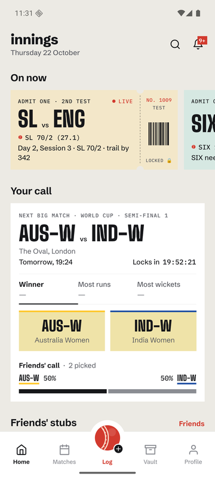
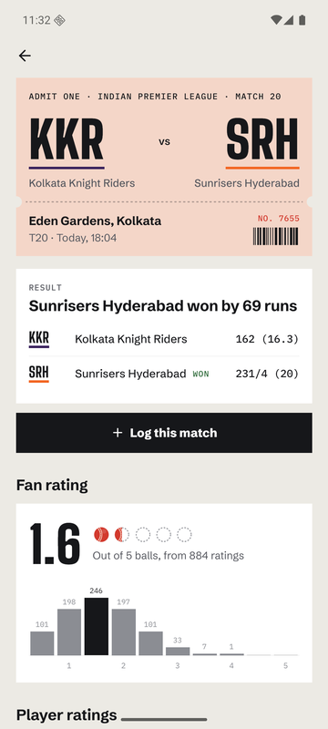
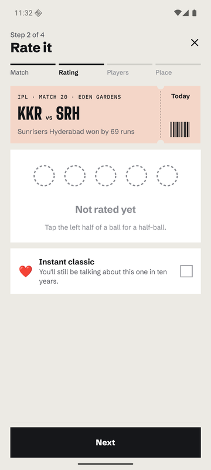
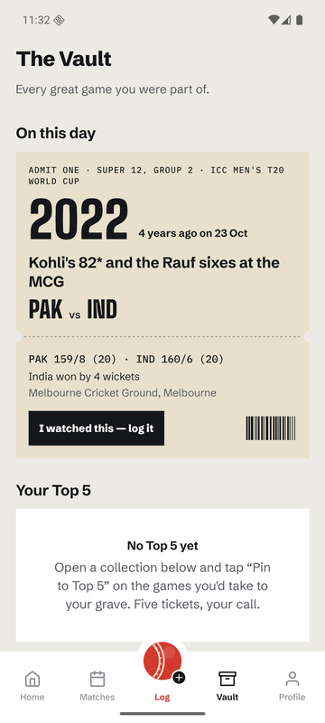
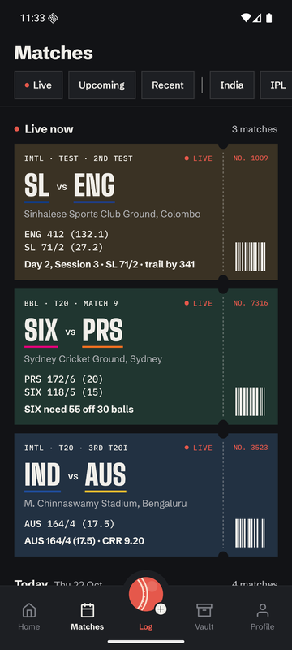
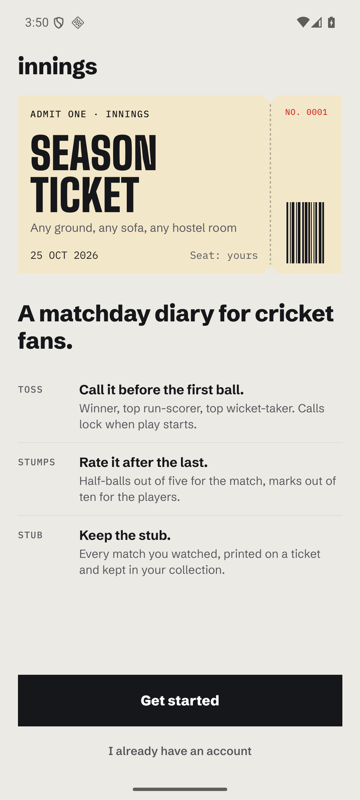
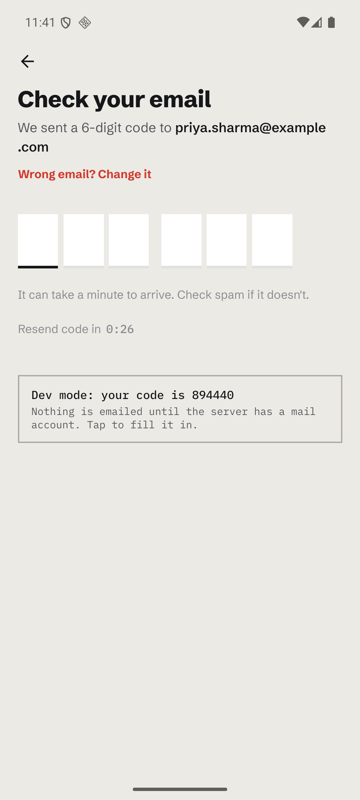
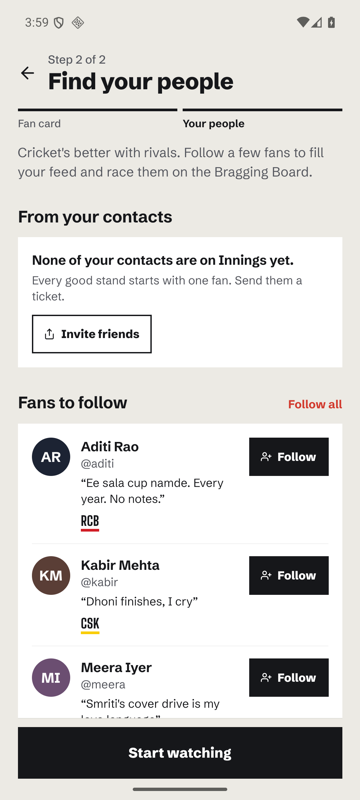
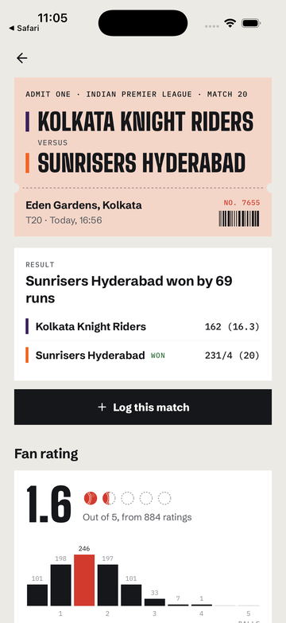
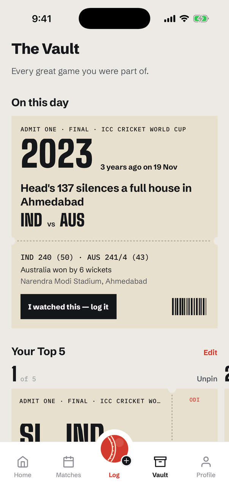

# Innings

**A matchday diary for cricket fans.** Log every match you watch, call it before the first ball, rate the players out of 10, remember where you watched it, and keep a collection of ticket stubs for every game that mattered to you.

I took this from a written plan to a working app for iPhone and Android by directing Claude Code, Anthropic's AI coding assistant. The idea, the plan and the product calls (a Go backend, the Matchday Ticket look, one app for both phones) are mine; Claude wrote the code to my prompts. The app is React Native with Expo, backed by a Go API and SQLite.

**Docs:** [Requirements](docs/REQUIREMENTS.md) · [Product plan](docs/PLAN.md) · [API](docs/API.md) · [Build record](.planning/ROADMAP.md)

**On Android** (Pixel 8 emulator):

| Home | Matches | Match Page | Log it |
| --- | --- | --- | --- |
|  |  |  |  |
| **The Vault** | **Profile** | **A friend's stub** | **Floodlights** |
|  |  |  |  |

**Signing up** (Android): the welcome screen is one big match ticket that rolls through real matches like a scoreboard, with your rating filling in, a LOGGED stamp, where it was played and a fun fact on the stub. Then come your email and a password, a 6-digit code we email you, your fan card and your people.

| Welcome | The code | Fan card | Find friends |
| --- | --- | --- | --- |
|  |  |  |  |

**On iPhone** (iPhone 17 Pro simulator):

| Home | Match Page | Log it | The Vault | Profile | Floodlights |
| --- | --- | --- | --- | --- | --- |
|  |  |  |  |  |  |

## The idea

Cricbuzz tells you **what happened**. CricHeroes helps you **score your own games**. Nobody captures **how fans felt**.

Innings treats every match like a release on opening night, the way Letterboxd treats films. Fans rush in after the last ball to rate it, crown their own Player of the Match and say where they watched it. Before the first ball they make their call and earn bragging points when they're right. Between series, the Vault keeps the app alive with the classics everyone remembers where they were for.

## What you can do

| Tab | What's there |
| --- | --- |
| **Home** | Live and today's matches as tickets, *Your Call* on the next big match (winner, top run-scorer, top wicket-taker in three taps), friends' stubs with likes, replies and "I was there too", matches that just finished with the fans' verdict, and the week's Bragging Board. |
| **Matches** | Live, upcoming and recent matches by day, filtered by India, IPL, WPL, World Cup, BBL, SA20 and The Hundred. The **Match Page** changes with the match: predictions and "I'm watching" before, the live score and friends watching during, then the fan rating, fan player ratings, the Fans' Player of the Match ("Fans disagree!" when it isn't the official one), who called it and where fans watched. Once a match is over you can rate it with a tap, pin it to your Top 5 and write a review, right on its page. |
| **Log** (the red ball) | A four-step log in under a minute: pick the match (any World Cup, Champions Trophy, Asia Cup or IPL game since 1973 too), rate it in cricket balls (half-balls too), rate both XIs out of 10 and pick your Player of the Match, then say where you watched it and with whom. It prints a ticket stub with a LOGGED stamp you can share as a story. |
| **Vault** | 58 classic matches in five collections (World Cup Finals, Greatest Chases, Test Match Thrillers, Super Over Madness, Women's Cricket Classics), all-time fan rankings by format and era, On This Day, and your Top 5, pinned from any match page and reordered or trimmed under Edit. |
| **Profile** | Your Top 5 as big tickets, matches logged, average rating, prediction accuracy and points, every stub you've collected, where you've watched from, and your rank among friends with badges like *Called the Upset*. |

Signing up asks for just an email and a password. We email a 6-digit code to that address, and the account opens when you type it in, so nobody can sign up with someone else's email. New fans then set up a fan card with their name, a unique @username and the teams they back (up to five, any of the international sides or all 10 IPL sides, with the first as their main team), and find friends from their contacts: the email addresses are hashed on the phone and never stored. They can invite the rest, or follow a few fans to fill the feed. After that you sign in with your email and password on any phone. "Forgot password?" emails a code to set a new one, and doing that signs out every other phone. Settings has change password, which also signs out your other phones, sign out, and delete account, which asks for your password first.

Every real match has a chat room, reached from its Match Page. It opens a day before the first ball and closes a day after the match, with the live score pinned above the messages and new ones arriving every few seconds. The app also asks its own calls while the match is on: where the side batting first will finish, whether the chase will come off, and whether a batter will reach 50 or 100. Each locks at a set point, settles itself from the score and is worth 5 bragging points when you're right. Yes/no calls are drawn as a ticket torn in two, each half filling with the share of fans behind it, and total calls as a scoreboard gauge with a pointer on the score. Fans can make their own calls too, with the Call button in the chat: a batter to make 30, 50 or 100, a team to reach a total, or a team to win. The call goes into the chat for everyone to answer, and is refused once it's as good as decided. Each fan gets five a match.

## Key decisions

| Decision | What I chose | Why | What it costs |
| --- | --- | --- | --- |
| Backend | A Go API (standard library `net/http`) with SQLite, instead of the Supabase the plan suggested | Go is what I build backends in. SQLite with embedded migrations means `make api` runs with no setup; the SQL stays Postgres-ready. | No managed storage yet: photos stay on the phone. |
| Accounts | An email and a password, with a 6-digit code emailed to confirm the address, and a unique @username. It replaced the phone number and texted code that sign-in started with, like Beli's | Texts cost money for every sign-in, and without them nobody checked the phone number, so anyone could type in another fan's number and pose as them. An emailed code costs nothing through an ordinary Gmail account and proves the address before the account opens. | Fans have a password to remember, so "Forgot password?" emails a code. Real emails need a mail account's settings in `.env` (see [Real emails](#real-emails)); until then the server runs in dev mode and shows the code on screen. |
| Teams | A fan backs up to five teams, main team first | A fan often backs a country and an IPL side, so one favourite team was too few. The main team still leads the fan card, so everything that shows one team keeps working. | |
| Phones | One Expo / React Native app for iPhone and Android | One codebase, native on both. Phone screens can't be built well in Go, so Go does the server and the app does the screens. | Two languages in one repo. |
| Match data | Real fixtures, live scores, squads, playing XIs and results from ESPN's public scores feed, the same data as ESPNcricinfo. `INNINGS_MATCHES=sim` runs a simulated world instead | Predicting and logging only mean something on real matches, and the feed needs no account or key and costs nothing. One poller on the server serves every fan from its own copy, so the app never calls ESPN, and matches are kept after they finish so logs and predictions always find them. It looks a week ahead, so squads appear as soon as they're announced, and checks every five minutes before the toss for the playing XIs. After time off (the server stopped, or the Mac asleep) it catches up on the days it missed, up to two weeks back. | It isn't an official API, so ESPN can change it without notice. The code reads it defensively, and its tests run on saved real responses. It's fine for a personal app, not a commercial one. Simulated fans don't predict, rate or watch real matches, so those start empty until real fans arrive. |
| The Vault | Real matches only, each fact-checked | Fans know these games by heart; one wrong date ruins the trust. All 58 were checked against public scorecards; sources are in [`docs/VAULT_SOURCES.md`](docs/VAULT_SOURCES.md). | Slower to grow by hand. |
| Past matches | Innings' own archive of every World Cup (men's and women's, ODI and T20), Champions Trophy, Asia Cup and IPL season since 1973: 2,948 matches in `internal/sim/archive.json`, found by search and logged like any other | ESPN's feed only answers for recent days, and fans want to log games they saw years ago. `python3 scripts/archive.py` builds the file from Wikipedia's tournament pages, read through Wikipedia's own API and no other site, and checks itself: each tournament's count must match its page, each winning margin must match the scores, and every ground must be in a host country. The app never contacts Wikipedia. | Compiled by the script, not checked by hand like the Vault. Four games where Wikipedia's own margin and scores disagree are left out, as are four walkovers nobody played. Renamed IPL sides go by today's names. The facts come from Wikipedia ([CC BY-SA 4.0](https://creativecommons.org/licenses/by-sa/4.0/)). |
| Ratings | Five cricket balls with half-balls, everywhere | The plan's signature detail. One scale for logging, averages and rankings. | |
| Predictions | Lock at the first ball; an upset is measured on the fans' split at lock time | Nobody can call it after seeing the toss, and an upset means the same thing for everyone. | |
| Bragging points | +10 winner, +15 top scorer, +15 top wicket-taker, +10 upset; 3–4 correct winners in a row ×1.5, 5+ ×2 | The plan said streaks multiply but not how; this keeps a hot streak worth chasing without swamping single matches. Tied top scorers all count. | |
| Look | "Matchday Ticket": every match printed as a ticket on its competition's card stock | The first pass (a paper scorebook) felt generic. I sketched three directions and chose the one that makes the stub worth sharing. | |

The full plan, with every decision that filled a gap, is in [`docs/PLAN.md`](docs/PLAN.md). What the app has to do, how each requirement is checked and where it's built is in [`docs/REQUIREMENTS.md`](docs/REQUIREMENTS.md): all 79 built. The build was run as GSD phases; the roadmap and per-phase plans and summaries are in [`.planning/`](.planning).

## What's left out on purpose

- **Live mood reactions, Season Wrapped, team fan clubs and AI summaries of reviews.** The plan marks these as later.
- **Store releases.** The same code builds for iPhone and Android, and both have been run: on the iOS Simulator and on an Android emulator. On a real phone, install a development build (`npx expo run:android --device`, or `npx expo run:ios --device` with a free Apple ID); Expo Go from the stores only opens projects on the newest Expo SDK. App Store and Play Store builds need developer accounts.
## How it's built


- **App:** Expo SDK 57, Expo Router, React Query, react-native-svg and Reanimated. The design system lives in `src/theme` and `src/components`: the ticket stub, ball ratings, the LOGGED stamp.
- **API:** Go 1.26, standard library HTTP, `modernc.org/sqlite`. The JSON contract is `src/domain/types.ts` and `src/domain/api.ts`, mirrored in `internal/domain`. Endpoints are listed in [`docs/API.md`](docs/API.md).
- **Tests:** table tests for scoring and aggregates, `httptest` checks for every endpoint (including that no list ever comes back as `null`), tests that the simulated world is deterministic, and tests of the real-match feed against saved ESPN responses. Sign-up, codes, passwords and the rate limits have their own tests, and the mailer is tested against a mail server on the same machine. Jest tests cover the app's pure helpers (the log draft, the Top 5, the sign-up checks, contact emails and teams), and `scripts/smoke.py` runs 88 checks against a fresh server, from sign-up to deleting the account.

## Run it

You need Go 1.26+, Node 20+, and Xcode (iOS Simulator) or Android Studio (Android Emulator). For a real phone, see below.

```bash
make api          # Go API on http://localhost:8088; sign-up codes show on screen until .env is set up (creates innings.db on first run)
npm install
make app          # Expo dev server; press i for iOS, a for Android
```

Matches are real by default. When it starts, `make api` fetches today's matches and the week ahead from ESPN's public scores feed. After that it checks every minute while a match is on and every five minutes otherwise, and keeps everything in the database. To run the simulated world instead, for example offline, start it with `INNINGS_MATCHES=sim make api`.

On a real phone, connect it by cable and run `npx expo run:android --device` or `npx expo run:ios --device`. Keep the phone on the same Wi-Fi as your computer: the app finds the API there automatically. Set `EXPO_PUBLIC_API_URL` to point it somewhere else.

If you installed a build from before sign-in existed, install again. Sign-in added native pieces (secure storage for the session, contacts, hashing) that an old build doesn't have. If you already have `ios/` or `android/` folders from that earlier build, run `npx expo prebuild --clean` first so they pick up the new permissions, then `npx expo run:ios` or `npx expo run:android`. A build from the phone-number days still works with email sign-in, but build again to update the wording of the contacts prompt.

To try it, tap Get started and sign up with any email address and a password of at least 8 characters. In dev mode nothing is emailed: the code shows on the screen, so tap it to fill it in, and it's in the server log too. A database from the phone-number days keeps its data, but those accounts can't sign in any more; `make reset-db` starts afresh.

```bash
make test         # Go tests, then the Jest tests
npx tsc --noEmit  # TypeScript check
npx expo lint     # lint
make reset-db     # start again with an empty database
```

### Real emails

`make api` emails real codes once a file named `.env` in the repo root holds a mail account's settings. The file is gitignored, so the password stays on your computer. To send from Gmail, turn on 2-Step Verification for the Gmail account, then create an app password at [myaccount.google.com/apppasswords](https://myaccount.google.com/apppasswords). Add these lines to `.env` with your own address, typing the app password without its spaces:

```
SMTP_HOST=smtp.gmail.com
SMTP_PORT=587
SMTP_USERNAME=you@gmail.com
SMTP_PASSWORD=yourapppassword
MAIL_FROM="Innings <you@gmail.com>"
```

Restart `make api`. Its log then says `sign-up emails: SMTP`, codes arrive by email and stop showing on the screen. Never paste these lines into a chat: anyone with the app password can send mail as you. Real delivery hasn't been tried yet, so the first real sign-up is the test.

## Project layout

```
cmd/api            Go server entry point
internal/httpapi   routes and handlers
internal/store     SQLite storage and migrations
internal/feed      real matches from ESPN's scores feed: polling, mapping, saving
internal/sim       simulated fixtures, friends, crowd and the Vault
internal/domain    JSON types, scoring, aggregates
src/app            Expo Router screens (tabs, match, log, vault, profile)
src/features       screen components by area
src/components     design system: tickets, ball ratings, stamp
docs               plan, requirements, API reference, Vault sources
.planning          GSD project record: requirements, roadmap, phases
```
